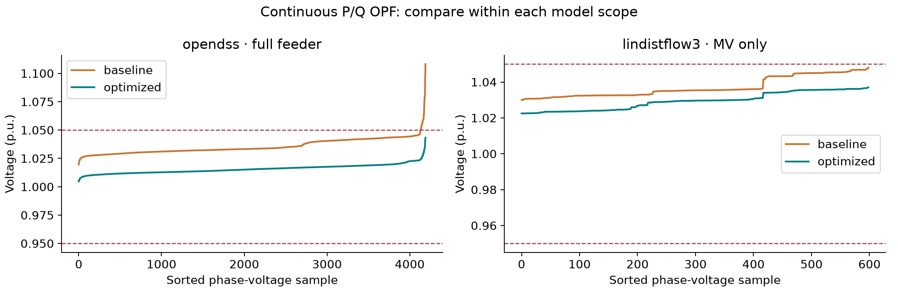
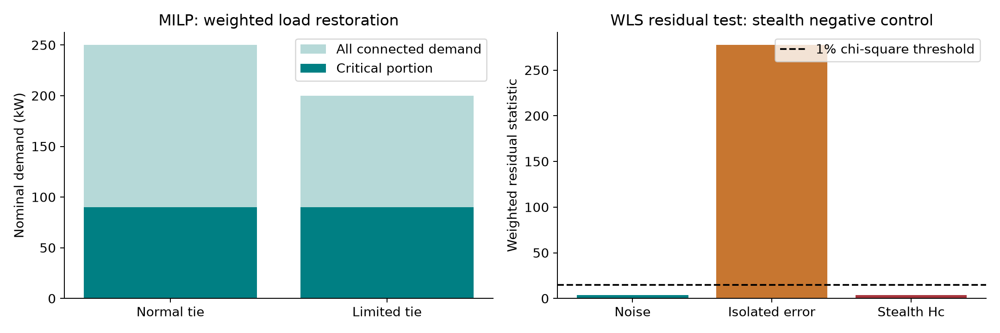

# Results for the three established-method demonstrations

This record accompanies [Standard_Formulations.ipynb](../Standard_Formulations.ipynb). The mathematical models and primary references are in [General Optimization Formulations](General_Optimization_Formulations.md). These are separate experiments from the original 32-run finite-catalog workflow study.

## Voltage support

The experiment solves local sensitivity QPs for two shared continuous inverter controls, using fresh selected-model validation and per-device setpoint tracking checks. It is a restricted one-step Volt/VAR optimization, not globally optimal AC OPF or a new multi-step P/Q MPC. Available active power is set to each inverter's kVA rating as a declared teaching overlay. The objective is `(1-a)^2 + 0.05*b^2 + 10*mean((v_pred-1.01)^2)`.

| Prediction/validation scope | Optimized P (kW) | Optimized Q (kvar) | Maximum voltage (p.u.) | Maximum line utilization | Model check |
|---|---:|---:|---:|---:|---|
| OpenDSS, supplied full feeder | 2,904.284 | +345.605 | 1.04322 | 99.89% | Pass |
| Three-phase LinDistFlow, MV network | 7,727.471 | −1,248.592 | 1.03701 | 65.33% | Pass within MV scope |
| Separate OpenDSS audit of the linear proposal | 7,727.471 | −1,248.592 | 1.08707 | 288.24% | Fail |

Positive Q means injection and negative Q absorption in the adapter. The full-AC audit reports 15 high-voltage phase samples and 10 overloaded lines. It does not repair the linear recommendation. The linear baseline is already feasible within MV coverage. The AC no-support baseline is infeasible despite its smaller unconstrained cost; restoring feasibility increases that cost. Both the constraints and the averaged voltage objective cover different node sets across models, so differences in optimal controls are not a pure numerical-approximation experiment. Use the earlier matched-common-MV audit for that separate question.

## Restoration

The six-node graph MILP maximizes weighted picked-up demand. Two load blocks have weight 10, and the remaining blocks have weight 1. Commodity flow proves source connectivity, and an energized-edge count enforces a tree. The damaged branch remains unavailable. The second optimization preserves maximum weighted service and minimizes energized-branch count with a small deterministic edge-index tie-break; it does not minimize operations from a known pre-fault switching state.

| Capacity of tie_04 | Served load | Critical served load | Weighted objective | Independent enumeration |
|---|---:|---:|---:|---|
| 220 kW | 250 kW | 90 kW | 1,060 weighted kW | Same optimum |
| 100 kW | 200 kW | 90 kW | 1,010 weighted kW | Same optimum |

The graph includes another supply path, so total service may exceed the named tie capacity. These are active-power transport constraints, not AC line-current or voltage constraints. The graph is a declared small teaching example, not an extracted Greensboro switching model. The original feeder restoration cases remain available for electrical checks on their restricted configuration catalog.

## Cyber-attack response

Eight noisy measurements estimate three non-reference DC bus angles. The nominal false-alarm level is 1%, with five residual degrees of freedom and a chi-square threshold of approximately 15.086. All three scenarios share the same seed-11 noise realization.

| Scenario | Residual statistic | Alarm | Consequence in the small DC model |
|---|---:|---|---|
| Nominal noise | 3.920 | No | Constrained redispatch passes the known-state check |
| Isolated flow corruption | 277.497 | Yes | Untrusted estimate cannot authorize a new redispatch |
| Structured shift a = Hc | 3.920 | No | Biased estimate leads to one overloaded branch |
| Recovery from assumed protected angle measurements | Not statistically tested | No residual redundancy | New constrained redispatch has zero toy-model violations |

The trusted recovery has rank three but zero residual degrees of freedom. It assumes trustworthy independent channels; the experiment does not authenticate them. Its estimated angles genuinely enter the scalar DC redispatch optimizer. This is a complete estimator-to-controller example within the four-bus DC model, not a feeder-wide AC cyber-resilience result. A few scenarios do not establish an attack-detection rate.

## Agent-stage integration

`src/standard_agent_workflow.py` invokes the same methods with a fixed supervisor and with actual local Llama routing and explanation. The four specifications are OpenDSS voltage support, LinDistFlow voltage support, limited-capacity graph restoration, and trusted DC recovery. Each permits one numerical attempt. Eight workflow records and eight actual model calls are supplied in `results/standard_agent_workflow.json` and its named journal.

All four paired specifications produce the same numerical solution. Both voltage routes reach a model-scope recommendation under both supervisors. In the restoration and cyber runs, Llama selects the appropriate numerical method, the numerical checks pass, and its Explanation choice is `REVIEW`. The wrapper conservatively withholds the recommendation. The response label has broad wording in this protocol; this outcome is not proof of engineering infeasibility or a measured coordination advantage. The exact response remains visible in the notebook and presentation.

The local baseline is deliberately competent: it calls the same optimizer, with the same inputs and checks. Numerical gains over a no-support operating point belong to the optimizer. The recorded language-interface experiments in the original tutorial address a different question about interpreting authored operator requests.

`results/standard_stage_20260921T143507Z_20d66560` is an earlier integration-development run before the final per-inverter tracking checks. The final run is `results/standard_stage_20260921T143826Z_42d19a61`; its numerical source hash matches the finalized module. The development journal is retained separately and is excluded from the final eight-run comparison.

The workflow never dispatches equipment. All acknowledgment stages remain PENDING. The operator dashboard illustrates the separate feeder-study review records; it does not acknowledge these new examples on anyone's behalf.
